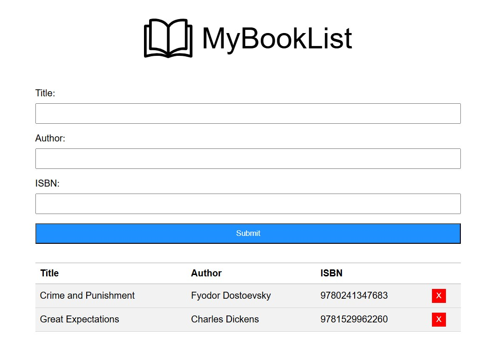

# MyBookList - A Vanilla JavaScript Practice Project


This is a personal practice project built to strengthen my Vanilla JavaScript and DOM manipulation skills. The goal was to build a simple book list application where users can add and delete books, with proper form validation and a clean UI.

## Table of contents

- [📝 Overview](#-overview)
  - [📸 Screenshot](#-screenshot)
  - [🔗 Links](#-links)
- [🛠️ My process](#️-my-process)
  - [🧱 Built with](#-built-with)
  - [📂 Folder Structure](#-folder-structure)
  - [💡 What I learned](#-what-i-learned)
  - [🤝 AI Collaboration](#-ai-collaboration)
- [📄 License](#-license)
- [👤 Author](#-author)

## 📝 Overview

### 📸 Screenshot



### 🔗 Links

- **Repository**: [GitHub Repo](https://github.com/Ali-Zol/vanilla-js-booklist.git)

## 🛠️ My process

### 🧱 Built with

- Semantic HTML5 markup (`<header>`, `<section>`, `<form>`, `<table>`)
- Modern CSS with Flexbox for layout
- Vanilla JavaScript (ES6+) for DOM manipulation
- Event Delegation pattern for handling dynamically created elements
- Regular Expressions (Regex) for form validation

### 📂 Folder Structure

```text
/
├── index.html
├── style.css
├── main.js
├── screenshot.jpg
├── LICENSE
├── open-book-icon.svg
└── README.md
```

### 💡 What I learned

This project was an excellent opportunity to move beyond basic DOM manipulation and explore more advanced JavaScript patterns. Some of the key takeaways include:

1. **Event Delegation**: Instead of attaching an event listener to every single delete button (which would be inefficient and memory-heavy), I attached one listener to the parent `<tbody>` element. This pattern works for dynamically created elements too, which is a game-changer for any list-based UI.

    ```js
    bookListTbody.addEventListener('click', deleteBook);

    function deleteBook(e) {
      if (!e.target.closest('.delete-btn'))
        return;
      // ...
    }
    ```

2. **The power of `closest()`:** I learned why `closest()` is more reliable than `parentElement` chains. When a button contains nested elements (like a `<span>`), `e.target` might be the span, not the button. Using `e.target.closest('.delete-btn')` makes the code resilient to structural changes.
3. **Managing `setTimeout` properly:** I discovered a subtle "race condition" bug where multiple error messages could overlap and cancel each other's timers. The solution was to store the timeout ID in a variable and call `clearTimeout()` before setting a new one.

    ```js
    let msgTimerId = 0;

    function showMessage(text) {
      clearTimeout(msgTimerId);
      msgTimerId = setTimeout(() => { /* ... */ }, 3000);
    }
    ```

4. **Form Validation with Regex:** Instead of using multiple `if` statements for validation, I used a single Regular Expression to validate ISBN input (exactly 13 digits) — a much cleaner and more precise approach.
5. **DRY Principle:** I refactored repeated code (like clearing error messages) into small helper functions (`showMessage`, `clearMessage`), making the `addBook` function much more readable.

### 🤝 AI Collaboration

I used an AI mentor (DeepSeek) throughout this project, but with a strict learning-focused approach:

- **How I used it:** Instead of asking for complete code solutions, I used the AI to review my code, explain why certain JavaScript behaviors occur (like the `setTimeout` race condition), and guide me toward finding the right properties and methods myself.

- **Outcome:** This collaborative approach ensured that I actually understood the underlying concepts — such as Event Delegation and `closest()` — rather than just copying and pasting code. Every line of code in this project was written by me.

## 📄 License

This project is open source and available under the [MIT License](LICENSE).

## 👤 Author

- Ali-Zol - [GitHub](https://github.com/Ali-Zol)
